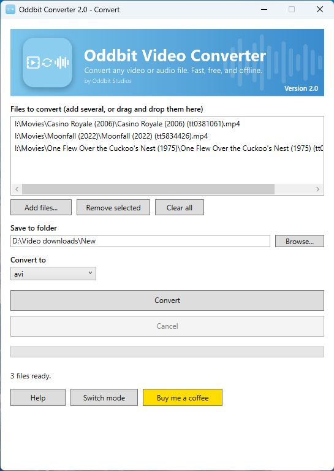
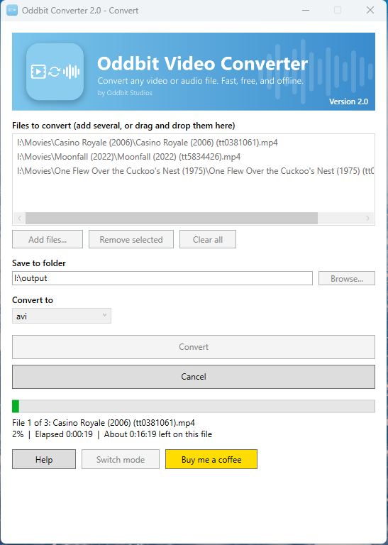

# Oddbit File Converter

A free, simple Windows app that converts almost any video or audio file into another format. Drop in your files, pick an output format, and click Convert. Everything runs on your own computer, so your files are never uploaded anywhere.

Made by [Oddbit Studios](https://oddbitstudios.com).

## Download

Get the latest installer from the [Releases page](https://github.com/oddbitstudios/File-Converter/releases/latest) and run it. You don't need to install .NET or FFmpeg separately, because both are bundled with the app.

Windows may show a blue "Windows protected your PC" screen the first time, because the installer isn't code-signed yet. Click **More info**, then **Run anyway**.

## What it does

Convert any video to another video format, or pull the audio out of a video and save it as an audio file. You can queue up as many files as you like and convert them all in one go. The app shows a progress bar and an estimated time remaining, and you can cancel at any point. If you cancel, the unfinished file is deleted so you aren't left with a broken one.

**Video output formats:** MP4, MKV, MOV, M4V, TS, AVI, WebM, WMV

**Audio output formats:** MP3, M4A, AAC, FLAC, WAV, OGG, Opus, WMA

Most common input files will work, including MKV, AVI, MOV, MP4, WebM, and common audio files.

## How to use it

1. Open the app and choose what you want to do: convert video, or extract audio.
2. Click **Add files**, or drag files from Explorer into the list.
3. Choose an output folder and an output format.
4. Click **Convert**. A sound plays when the batch is finished.

Use **Switch mode** at the bottom of the window to go back and choose a different task. If a file with the same name already exists in the output folder, the new one is saved with "(2)" added so nothing gets overwritten.

## Requirements

Windows 10 or 11, 64-bit. No other software is needed.

## Troubleshooting

**A file failed to convert.** The app lists any problem files when the batch finishes. The file may be damaged, copy-protected, or in an unusual format. Try a different output format.

**Conversion is slow.** Large or high-resolution videos take time, especially when changing formats. The estimated time remaining gets more accurate after the first few seconds.

**The installer is blocked by SmartScreen.** See the note under Download above.

## Built with

C# and WPF on .NET 8, using [FFMpegCore](https://github.com/rosenbjerg/FFMpegCore) to drive FFmpeg.

## Licenses

The app is free to use. It includes FFmpeg, which is licensed under the GPL; see [ffmpeg.org](https://ffmpeg.org) for its source code and license terms.

## Support

If the app saved you some time, you can [buy me a coffee](https://www.buymeacoffee.com/oddbitstudios). Questions or problems can be reported on the [Issues tab](https://github.com/oddbitstudios/File-Converter/issues).
